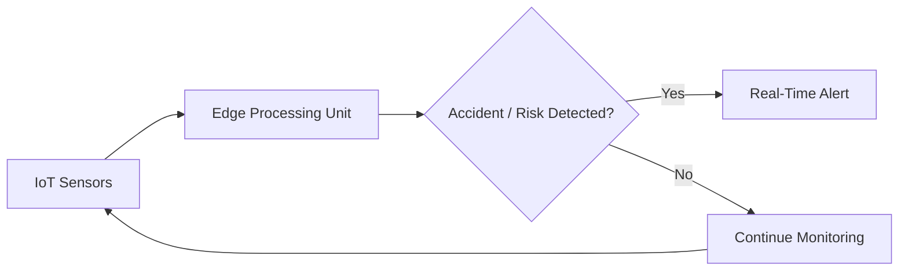
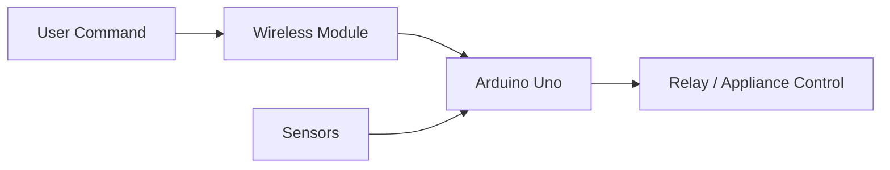

<!-- 
  SETUP: replace every YOUR_USERNAME below with your GitHub username.
  Repository name must equal your username for this to show on your profile.
-->

<div align="center">


<a href="https://git.io/typing-svg"></a>

<br/>

[](https://www.linkedin.com/in/manikandan-mathiyalagan/)
[](mailto:kandan.2507@gmail.com)


</div>

---

## 👨‍💻 About Me

Electronics & Communication Engineering graduate (**B.E., Annamalai University, CGPA 8.2**) specializing in **embedded firmware, microcontroller interfacing and IoT system design**. I build systems end to end: from circuit validation and sensor interfacing to firmware logic and real-time alerting.

```c
#include <stdio.h>

typedef struct {
    const char *name;
    const char *role;
    const char *focus[4];
    const char *protocols[4];
    int         open_to_work;
} Engineer;

int main(void) {
    Engineer me = {
        .name         = "Manikandan M",
        .role         = "Embedded Systems / Electronics Engineer",
        .focus        = { "Embedded C", "IoT", "Real-Time Systems", "Debugging" },
        .protocols    = { "I2C", "SPI", "UART", "CAN" },
        .open_to_work = 1
    };
    printf("%s | %s\n", me.name, me.role);
    return 0;
}
```

---

## 🧰 Technical Arsenal

<div align="center">


</div>

| Domain | Stack |
|---|---|
| **Firmware** | Embedded C · C++ · Python |
| **Platforms** | Arduino Uno · Microcontroller-based design |
| **Protocols** | I2C · SPI · UART · CAN |
| **IoT** | Sensor interfacing · Wireless modules · Real-time alerting |
| **Validation** | Circuit simulation · Hardware troubleshooting · Testing & debugging |
| **Supporting** | Cloud computing · Cryptography & network security |

---

## 💼 Experience

<table>
<tr>
<td width="25%"><b>Embedded Systems Intern</b><br/>Codebind Technologies<br/>Tiruchirappalli</td>
<td>

- Designed and tested electronic circuits using simulation tools, **improving reliability during validation**
- Applied microcontroller and embedded systems fundamentals to support **successful project implementations**
- Diagnosed and resolved hardware faults on the **Arduino Uno** platform

</td>
</tr>
</table>

---

## 🚀 Featured Projects

### 🚗 Edge AI-Based Smart Accident Detection & Risk Prediction System

> **Problem:** Manual accident reporting causes critical delays, especially when victims are unconscious after a collision.
> **Solution:** A low-cost system that detects accidents instantly with IoT sensors, assesses risk at the edge and triggers real-time alerts.

`IoT Sensors` `Edge AI` `Real-Time Alerts` `Embedded C`



<!-- Add: [Source Code](link) · [Demo](link) · [Report](link) -->

### 🏠 Smart Home Automation using Arduino Uno

> **Problem:** Household appliances need manual, on-site control.
> **Solution:** A sensor and wireless-module-based system for remotely switching appliances on and off.

`Arduino Uno` `Sensors` `Wireless Modules` `Embedded C`



<!-- Add: [Source Code](link) · [Demo](link) · [Circuit Diagram](link) -->

---

## 📊 GitHub Stats

<div align="center">


</div>

---

## 🎓 Education & Certifications

<details open>
<summary><b>Education</b></summary>

| Qualification | Institution | Period | Score |
|---|---|---|---|
| B.E., Electronics & Communication Engineering | Annamalai University, FEAT | 2022 - 2026 | CGPA 8.2 |
| Senior Secondary (XII) | Lakshmi Matriculation Higher Secondary School | 2021 - 2022 | 79.1% |
| Secondary (X) | Lakshmi Matriculation Higher Secondary School | 2020 - 2021 | 80% |

</details>

<details open>
<summary><b>Certifications (NPTEL)</b></summary>

| Course | Duration | Coverage |
|---|---|---|
| Cloud Computing | Aug - Nov 2024 | Architecture and deployment models, virtualization, key-value/NoSQL storage, cloud networking and services |
| Cryptography and Network Security | Jan - Apr 2025 | Symmetric and asymmetric algorithms, hashing, digital signatures, authentication protocols, network security models |

</details>

---

## 🧭 Engineering Approach

- **Problem-solving:** isolate, reproduce, fix, then verify
- **Attention to detail:** validate circuits and firmware before deployment
- **Teamwork and communication:** clear hand-offs across hardware and software

---

<div align="center">

### 🤝 Let's Build Something Reliable

*Open to entry-level Embedded Systems and Electronics Engineer roles.*

[](https://www.linkedin.com/in/manikandan-mathiyalagan/)
[](mailto:kandan.2507@gmail.com)


</div>
